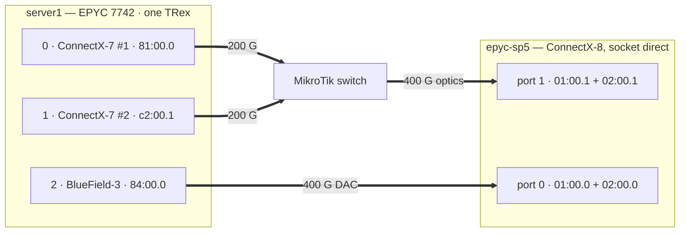

# server1 — EPYC 7742 + 2× ConnectX-7 + BlueField-3 (since 2026-10-28)

Since 2026-10-28 server1 drives epyc-sp5's socket-direct ConnectX-8 (two PCIe Gen5 x16 links,
two functions per port): both ConnectX-7 through a MikroTik switch into ConnectX-8 port 1
(400G optics), and a BlueField-3 in NIC mode, moved here from epyc-sp5, by DAC into ConnectX-8
port 0. The three ConnectX-5 Ex are no longer cabled. Measured 2026-10-29.

**Headline:** **560 Mpps at 64 B from the two ConnectX-7** (280 per port, 94 % of 200 G line
rate) when TRex gives them all its cores; **729–759 Mpps** with the BlueField-3 added; **400 Gbps at
1500 B** from the two ConnectX-7 (100 % of 2×200 G).



| TRex port | Card | PCI | Firmware | PCIe | Link | Receiver port |
|---|---|---|---|---|---|---|
| 0 | ConnectX-7 #1 | `81:00.0` | 28.44.1036 | Gen4 x16 | 200 G, to the MikroTik | ConnectX-8 port 1, function `01:00.1` |
| 1 | ConnectX-7 #2 | `c2:00.1` | 28.44.1036 | Gen4 x16 | 200 G, to the MikroTik | ConnectX-8 port 1, function `02:00.1` |
| 2 | BlueField-3 B3240, NIC mode | `84:00.0` | 32.49.1014 | Gen4 x16 (~252 Gb/s) | 400 G, DAC | ConnectX-8 port 0, alternating `01:00.0` / `02:00.0` |
| 3 | BlueField-3, port 1 | `84:00.1` | | | no cable | only completes TRex's second port pair |

Kernel 6.8.0-147-generic; TRex as below (trex-core master `27e0153b`). server1 has been off
the tailnet since the recabling (Tailscale logged out), so the bench reaches it through the
lab's management proxy.

### Results (2026-10-29)

Median of three 20 s trials; **sent** is `tx_packets_phy` on server1. Frames include the FCS;
Gbps is the rate on the wire, (frame + 20 B) × 8 per packet.

| Ports | TRex config | Frame | sent, total | per port | % of line rate |
|---|---|---|---|---|---|
| ConnectX-7 #1 alone | 2 ports, `-c 46` | 64 B | 280.0 Mpps | 280.0 | 94 % of 200 G |
| ConnectX-7 #2 alone | 2 ports, `-c 46` | 64 B | 280.0 Mpps | 280.0 | 94 % of 200 G |
| **both ConnectX-7** | 2 ports, `-c 46` | 64 B | **560.0 Mpps** | 280.0 + 280.0 | 94 % of 2×200 G |
| both ConnectX-7 + BlueField-3 | 4 ports, `-c 24` | 64 B | **729.5–758.9 Mpps** | 240.6–256.3 per ConnectX-7 + 246.4–248.2 | |
| **both ConnectX-7** | 4 ports, `-c 24` | 1500 B | 32.9 Mpps = **400 Gbps** | 16.4 + 16.4 | 100 % |
| BlueField-3 alone | 4 ports, `-c 24` | 1500 B | 16.4 Mpps = 200 Gbps | 16.4 | 50 % of 400 G (PCIe Gen4) |
| both ConnectX-7 + BlueField-3 | 4 ports, `-c 24` | 1500 B | 33.7 Mpps = **410 Gbps** | 11.2 + 11.2 + 11.3 | |

- **One ConnectX-7 port tops out at 280.0 Mpps**, the same in every trial and on both cards,
  and the same ~279 lava1's ConnectX-7 reached in July: the card's packet rate, not the cores.
  With 16 cores per pair (the six-port config below) a port sent ~260.
- **The BlueField-3 sends 248 Mpps at 64 B from one port** (24 cores), more than one ConnectX-7
  port, but only **200 Gbps at 1500 B**: the Rome slot is PCIe Gen4 x16, so the card's 400 G port
  gets half.
- **server1 sends ~410 Gbps at most in large frames**: the two ConnectX-7 alone reach 400 Gbps,
  and adding the BlueField-3 only redistributes it (11.2 + 11.2 + 11.3 Mpps). At 64 B the three
  cards send 729–759 Mpps (~370–390 Gbps of frame bytes). The host (Rome I/O die, memory) is the
  likely limit; a second generator host is needed to fill both 400 G ports of the ConnectX-8.
- **The MikroTik forwards everything it gets**: 560 Mpps of 64 B in, all of it counted by the
  ConnectX-8 port (`rx_packets_phy`). The receiver must not send PAUSE frames (see Gotchas).

Receiver side (what the ConnectX-8 and VPP did with it): fastacl-testbench reports
`2026-10-29_1215_epyc-sd-pps_platform` and `2026-10-29_1234_epyc-sd_platform` (the ConnectX-8 port
takes in ~226 Mpps of the 560 and FastACL drops all of it; 400 Gbps at 1500 B with no loss).

## Before 2026-10-28: six ports, 2× ConnectX-7 + 3× ConnectX-5 Ex

One TRex instance drove six ports on five cards, each cabled straight to a port of the
receiver, epyc-sp5 (two ConnectX-8 and a BlueField-3 in NIC mode). Measured 2026-10-09.

**Headline:** **893 Mpps at 64 B** from one host, all six ports at once, and 875 Mpps of it
counted by the receiver's NICs.

### Server configuration

| Item | Value |
|------|-------|
| CPU | AMD EPYC **7742** (Rome), 64 cores / 128 threads, one socket, one NUMA node |
| RAM | 256 GB, 8× DDR4-3200 |
| Kernel | 6.8.0-142-generic, `isolcpus=1-32`, no `iommu=pt` |
| NIC driver | `mlx5_core` (inbox) |
| TRex | built from **trex-core master `27e0153b`** (DPDK 25.07; banner says v3.08) |

| TRex port | Card | PCI | Firmware | PCIe | Link | Receiver port |
|---|---|---|---|---|---|---|
| 0 | ConnectX-7 #1 | `81:00.1` | 28.44.1036 | Gen4 x16 | 200 G | ConnectX-8 A, port 1 |
| 1 | ConnectX-7 #2 | `c2:00.0` | 28.44.1036 | Gen4 x16 | 200 G | ConnectX-8 B, port 1 |
| 2 | ConnectX-5 Ex #1 | `01:00.1` | 16.35.4030 | Gen4 x16 | 100 G | ConnectX-8 B, port 0 |
| 3 | ConnectX-5 Ex #1 | `01:00.0` | 16.35.4030 | Gen4 x16 | 100 G | ConnectX-8 A, port 0 |
| 4 | ConnectX-5 Ex #2 | `82:00.0` | 16.35.4030 | Gen4 x16 | 100 G | BlueField-3, port 0 |
| 5 | ConnectX-5 Ex #3 | `c1:00.0` | 16.35.4030 | Gen4 x16 | 100 G | BlueField-3, port 1 |

The ConnectX-7 cards are Gen5 and run at Gen4 here, the fastest the Rome board offers.

### Platform config

TRex pairs ports in order (0-1, 2-3, 4-5) and gives each pair the same number of cores.

```yaml
# /etc/trex_cfg.yaml (rendered by fastacl-testbench gen/conf/trex_cfg_multi.py)
- port_limit      : 6
  version         : 2
  port_mtu        : 9000
  interfaces      : ["0000:81:00.1", "0000:c2:00.0", "0000:01:00.1", "0000:01:00.0", "0000:82:00.0", "0000:c1:00.0"]
  port_info       :
    - ip          : "10.100.0.1"
      default_gw  : "10.100.0.2"
    # ... one entry per port
  platform        :
    master_thread_id  : 0
    latency_thread_id : 63
    dual_if           :
      - socket         : 0
        threads        : [1-16]
      - socket         : 0
        threads        : [17-32]
      - socket         : 0
        threads        : [33-48]
```

`t-rex-64 -i -c 16`: 16 cores per port pair, 48 in all.

### Results (64 B including FCS, one UDP stream per port, source address over 65,536 values)

Each row is the median of three 20 s trials. **sent** is `tx_packets_phy` on server1.

| Ports | sent, total (Mpps) | per port (Mpps) | % of line rate |
|---|---|---|---|
| ConnectX-7 #1 alone | 258 | 258 | 87 % of 200 G |
| ConnectX-7 #2 alone | 264 | 264 | 89 % of 200 G |
| ConnectX-5 #1, both ports | 200 | 99.8 + 99.8 | 67 % of 2×100 G |
| ConnectX-5 #2 + #3, one port each | 298 | 148.8 + 148.8 | 100 % |
| both ConnectX-7 | 447 | 223.5 + 223.5 | 75 % of 2×200 G |
| both ConnectX-7 + ConnectX-5 #1 | 632 | 216 + 216 + 99.9 + 99.9 | |
| **all six** | **893** | 198 + 198 + 99.9 + 99.9 + 148 + 148 | |

- **One ConnectX-5 Ex card sends ~200 Mpps** whether one or both ports run, about
  100 Mpps per port when both do. A single port reaches its 148.8 Mpps line rate, which is
  why the BlueField-3 is fed from two separate ConnectX-5 cards.
- **The 893 Mpps repeats**: the six-port stage of all three full runs on 2026-10-09 (reports `2026-10-09_1017`,
  `2026-10-09_1110` and `2026-10-09_1331` in fastacl-testbench) sent 890–893 Mpps. Single
  10-second runs in between sometimes reached only 715–780 Mpps, with the ConnectX-7 ports at
  136–167 Mpps instead of ~198; no PAUSE frames were exchanged and the cause is not known.
  Run several trials and use the median.
- **One ConnectX-7 port sends ~260 Mpps** with the pair's 16 cores to itself, and
  ~223 per port when both ConnectX-7 share those cores. With all six ports busy each drops
  to ~198. Not yet separated: TRex cores against the Rome host's I/O die. lava1's dual-port
  ConnectX-7 reached ~279 Mpps per card in July (see [lava1](lava1.md)).

### What the receiver needed

The generator side was straightforward once the gotchas below were handled. Taking 890 Mpps
in was the hard part: on the EPYC 9534 receiver, VPP dropped only 148 Mpps with 62 workers until
the BIOS went from one NUMA node per socket (NPS1) to four (NPS4), then 450 Mpps. Details in
fastacl-testbench `docs/lab.md` ("Tuning epyc-sp5").

## Gotchas

- **TRex allows at most 48 TX queues per port**, so one port pair can't take all 48 cores:
  `-c 48` on two ports fails with "Number of TX queues exceeds 48"; `-c 46` works.
- **A switch in the path honours PAUSE frames.** The ConnectX-8 receiver came up with flow
  control on (VPP's port start re-enables it after `ethtool -A ... rx off tx off`) and sent
  ~0.6 M PAUSE frames/s; the MikroTik then discarded ~180 Mpps that no receiver counter showed.
  Turn flow control off on the receiver after VPP starts. Port-to-port links never showed this:
  TRex's ports ignore PAUSE.
- **TRex runs at most 48 data-plane cores.** `-c 20` with three port pairs fails with
  "Your configuration require 60 DP cores but the maximum supported is 48".
- **The ConnectX-5 rejects TRex's default MTU** (65518): set `port_mtu: 9000`.
- **Mixed ConnectX-5 / ConnectX-7 ports break `STLClient.reset()`**: it fails with
  "Length of get_xstats_names: 102 and get_port_xstats_values: 87". Use `stop()` plus
  `remove_all_streams()` instead.
- **The ConnectX-5 to ConnectX-8 100 G DACs need autonegotiation off** on both ends
  (`ethtool -s <if> speed 100000 duplex full autoneg off`). One of the two links never came up
  with autonegotiation; the other came up at first and dropped after the receiver rebooted.
  Forcing both is reliable.

The orchestration (stages, counters) is `labs/hw/platform-ceiling.sh` in fastacl-testbench.
